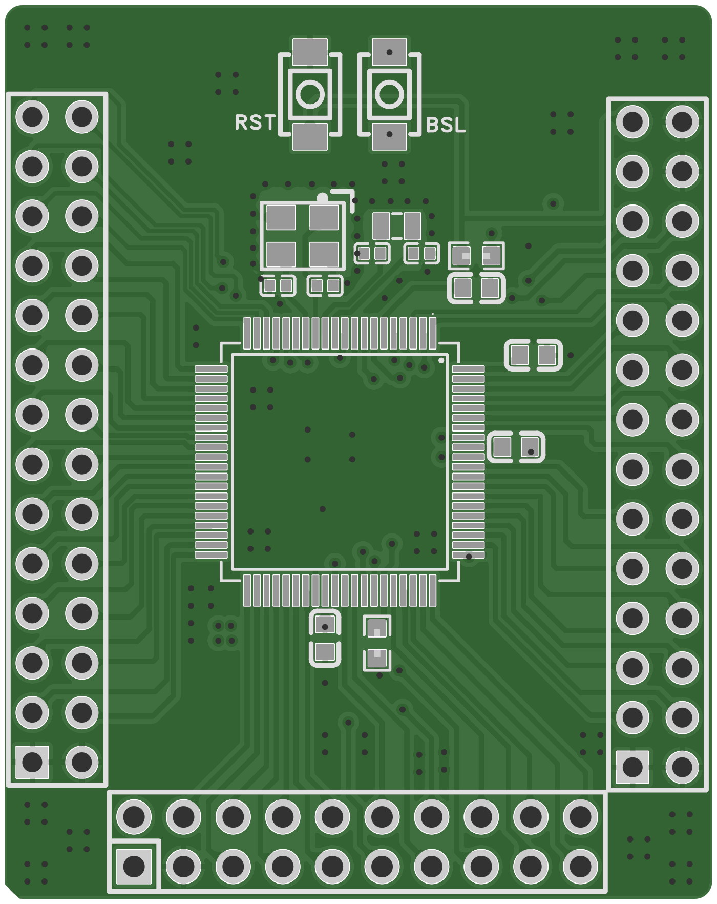
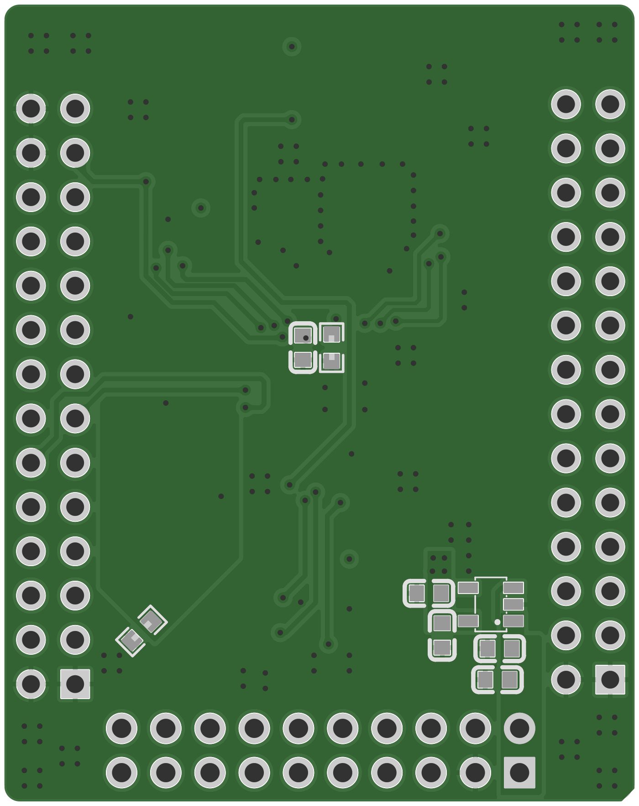

# R3 小车 TI 版核心板

基于 **TI MSPM0G3519（80 引脚）** 的核心板，提供 GPIO 扩展、SWD 信号引出、复位/BSL 按键，以及 40 MHz 和 32.768 kHz 晶体电路，供 R3 小车主控系统集成使用。

本仓库整理原理图 PDF、Gerber 生产包及接口文档。U2 型号由设计者确认为 MSPM0G3519；原始 PDF 的 U2 未显示型号，原文件保持原样。**尚未提供实板测试记录、原始 BOM、可编辑 EDA 工程或固件**，因此本文所列连接与参数属于设计资料核对结果。

## 主要参数

| 项目 | 参数 | 依据与状态 |
| --- | --- | --- |
| 主控 U2 | MSPM0G3519，80-PIN / PN LQFP | 设计者确认；完整采购订货后缀未提供 |
| CPU / 存储 | Arm Cortex-M0+，最高 80 MHz；512 KB Flash，128 KB SRAM | [TI 芯片规格](https://www.ti.com/product/MSPM0G3519)，并非实测运行配置 |
| 供电入口 | H1-1、H1-2：标称 +5 V；H1-3：GND | 原理图与飞针网络一致；整板输入容差未验证 |
| MCU 电源 | 板内 +3.3 V | U6：LN1134A332MR-G；VIN 与 CE 接 +5 V |
| 信号电平 | 以 3.3 V 逻辑连接外设 | 无板载电平转换；不要把所有 GPIO 当作 5 V 耐受端口 |
| 高频晶体 X1 | 40 MHz；C4、C8 各 20 pF | 原理图标值；负载电容匹配及起振未提供测试 |
| 低频晶体 X2 | 32.768 kHz；C5、C6 各 15 pF | 原理图标值；频率精度未提供测试 |
| 外接接口 | H1：20 针；U1、U4：各 28 针 | 引脚定义见下表 |
| PCB 外形 | 36.449 × 45.974 mm，四角 R1 mm | Gerber 板框中心线计算，未计 0.254 mm 描线宽度 |
| 铜层资料 | 顶层、内层 1、内层 2、底层，共四层铜文件 | 板厚、铜厚、层叠材料及表面处理未提供 |
| 电源/电流能力 | 整板输入范围、耗电和外设供电预算未确定 | 缺少 BOM 耐压/功率信息与温升记录；不将芯片额定值当作整板额定值 |

## 板图与资料

<table>
<tr><th>顶面观察</th><th>底面观察（已左右镜像）</th></tr>
<tr><td></td><td></td></tr>
</table>

预览由 Gerber 渲染，显示铜层、阻焊、丝印与钻孔；不是实物照片。绿色与灰色为渲染配色，不代表下单工艺。图中方形焊盘可辅助辨识 Pin 1，仍须结合封装编号核对。

| 文件 | 内容 |
| --- | --- |
| [hardware/schematic.pdf](hardware/schematic.pdf) | 原始 SCH_Schematic1_2026-10-10.pdf，逐字节保留 |
| [hardware/gerber.zip](hardware/gerber.zip) | 原始 Gerber_PCB1_2026-10-10.zip，含四层铜、阻焊、丝印、钢网、板框、钻孔与飞针网络数据 |
| [hardware/SHA256SUMS.sha256](hardware/SHA256SUMS.sha256) | 两份原始附件的 SHA-256 |
| [docs/bom-summary.md](docs/bom-summary.md) | 从原理图整理的器件摘要，不能替代采购 BOM |
| [docs/hardware-notes.md](docs/hardware-notes.md) | 参数、网络别名、生产文件及待验证项说明 |
| [docs/images/schematic.png](docs/images/schematic.png) | 原理图预览，以 PDF 为准 |
| [LICENSE](LICENSE) | MIT 许可证，Copyright (c) 2026 ZiYuan32 |

## 供电和接线

- 将稳压 **5 V 电源**接 H1-1/2，电源负端接 H1-3。1、2 脚属于同一 +5 V 网络，不是两路独立电源；不得接入两个不同电压的电源。
- U6 产生板内 3.3 V，U2 的 VDD（8、49 脚）接 3.3 V；VSS（9、48 脚）与全部 GND 接地。AGND 通过 R3（0 Ω）接 GND。
- U1/U4 的地脚与 H1-3 共地。三组接口均未引出独立 +3.3 V 电源脚。
- 外接 GPIO、模拟信号按 3.3 V 系统适配。当前图中无反接保护、输入保险丝或接口电平转换电路；实际电源及接口限值需结合元件采购规格确认。
- **H1 是自定义接口，不能直接插标准 ARM 20 针 JTAG/SWD 线。** 不要将 H1 的 +5 V 当作调试器的 3.3 V VTref。

## 逐脚接口定义

编号以原理图及 Gerber 内 FlyingProbeTesting.json 的封装引脚号为准。方向参考核心板 U2；GPIO 方向与复用功能由固件决定。表中的 ADC、时钟和定时器名称表示可选功能，不表示上电已启用。

**H1 的成对引脚是 1/2、3/4、…、19/20。U1、U4 使用沿两列绕行的编号，成对引脚是 1/28、2/27、…、14/15，不可套用奇偶交错编号。** 接线时按实际 Pin 1 和封装图核对；本文不凭接口缺口推断插接面的左右方向。

### H1：2×10 接口，DS1021-2x10SF11-B

| 引脚 | 信号/网络 | U2 引脚 | 方向及用途 |
| --- | --- | --- | --- |
| 1 | `+5V` | - | 外部电源→核心板；5 V 输入 |
| 2 | `+5V` | - | 外部电源→核心板；5 V 输入 |
| 3 | `GND` | - | 共地 |
| 4 | `PA12/A0_8/FCC_IN` | 41 | 外部↔U2；GPIO / 模拟输入（由配置决定） |
| 5 | `PA13/A0_9` | 42 | 外部↔U2；GPIO / 模拟输入（由配置决定） |
| 6 | `PA14/A0_12` | 43 | 外部↔U2；GPIO / 模拟输入（由配置决定） |
| 7 | `PA15/A1_0` | 44 | 外部↔U2；GPIO / 模拟输入（由配置决定） |
| 8 | `PA16/A1_1` | 45 | 外部↔U2；GPIO / 模拟输入（由配置决定） |
| 9 | `PC0/TIMG8_C0` | 46 | 外部↔U2；GPIO / 复用功能（由配置决定） |
| 10 | `PC1/TIMG8_C1` | 47 | 外部↔U2；GPIO / 复用功能（由配置决定） |
| 11 | `PC2` | 50 | 外部↔U2；GPIO / 复用功能（由配置决定） |
| 12 | `PC3` | 51 | 外部↔U2；GPIO / 复用功能（由配置决定） |
| 13 | `PC4` | 52 | 外部↔U2；GPIO / 复用功能（由配置决定） |
| 14 | `PC5` | 53 | 外部↔U2；GPIO / 复用功能（由配置决定） |
| 15 | `PA17/A1_2` | 54 | 外部↔U2；GPIO / 模拟输入（由配置决定） |
| 16 | `PA19/SWDIO` | 56 | 调试器↔U2；SWD 数据 |
| 17 | `PA20/SWCLK` | 57 | 调试器→U2；SWD 时钟 |
| 18 | `PB17/A1_4` | 58 | 外部↔U2；GPIO / 模拟输入（由配置决定） |
| 19 | `PB18/A1_5` | 59 | 外部↔U2；GPIO / 模拟输入（由配置决定） |
| 20 | `PB19/A1_6` | 60 | 外部↔U2；GPIO / 模拟输入（由配置决定） |

### U1：2×14 排针，HC-PZ254-11.5L-2x14PZ

| 引脚 | 信号/网络 | U2 引脚 | 方向及用途 |
| --- | --- | --- | --- |
| 1 | `GND` | - | 共地 |
| 2 | `PA22/CLK_OUT/A0_7` | 62 | 外部↔U2；GPIO / 模拟输入（由配置决定） |
| 3 | `PC7` | 64 | 外部↔U2；GPIO / 复用功能（由配置决定） |
| 4 | `PC9` | 66 | 外部↔U2；GPIO / 复用功能（由配置决定） |
| 5 | `PB21` | 68 | 外部↔U2；GPIO / 复用功能（由配置决定） |
| 6 | `PB23` | 70 | 外部↔U2；GPIO / 复用功能（由配置决定） |
| 7 | `PA24/A0_3` | 73 | 外部↔U2；GPIO / 模拟输入（由配置决定） |
| 8 | `PB25/A0_4` | 75 | 外部↔U2；GPIO / 模拟输入（由配置决定） |
| 9 | `PB27` | 77 | 外部↔U2；GPIO / 复用功能（由配置决定） |
| 10 | `PA27/A0_0` | 79 | 外部↔U2；GPIO / 模拟输入（由配置决定） |
| 11 | `PA1` | 2 | 外部↔U2；GPIO / 复用功能（由配置决定） |
| 12 | `PA29` | 4 | 外部↔U2；GPIO / 复用功能（由配置决定） |
| 13 | `PA31/CLK_OUT` | 7 | 外部↔U2；GPIO / 复用功能（由配置决定） |
| 14 | `NRST` | 6 | 外部→U2；低有效复位，与 SW1 共网 |
| 15 | `GND` | - | 共地 |
| 16 | `GND` | - | 共地 |
| 17 | `PA30` | 5 | 外部↔U2；GPIO / 复用功能（由配置决定） |
| 18 | `PA28` | 3 | 外部↔U2；GPIO / 复用功能（由配置决定） |
| 19 | `PA0/FCC_IN` | 1 | 外部↔U2；GPIO / 复用功能（由配置决定） |
| 20 | `PA26/A0_1` | 78 | 外部↔U2；GPIO / 模拟输入（由配置决定） |
| 21 | `PB26` | 76 | 外部↔U2；GPIO / 复用功能（由配置决定） |
| 22 | `PA25/A0_2` | 74 | 外部↔U2；GPIO / 模拟输入（由配置决定） |
| 23 | `PB24/A0_5` | 71 | 外部↔U2；GPIO / 模拟输入（由配置决定） |
| 24 | `PB22` | 69 | 外部↔U2；GPIO / 复用功能（由配置决定） |
| 25 | `PB20/A0_6` | 67 | 外部↔U2；GPIO / 模拟输入（由配置决定） |
| 26 | `PC8` | 65 | 外部↔U2；GPIO / 复用功能（由配置决定） |
| 27 | `PC6` | 63 | 外部↔U2；GPIO / 复用功能（由配置决定） |
| 28 | `GND` | - | 共地 |

### U4：2×14 排针，HC-PZ254-11.5L-2x14PZ

| 引脚 | 信号/网络 | U2 引脚 | 方向及用途 |
| --- | --- | --- | --- |
| 1 | `GND` | - | 共地 |
| 2 | `PB15` | 39 | 外部↔U2；GPIO / 复用功能（由配置决定） |
| 3 | `PB13` | 37 | 外部↔U2；GPIO / 复用功能（由配置决定） |
| 4 | `PB11/CLK_OUT` | 35 | 外部↔U2；GPIO / 复用功能（由配置决定） |
| 5 | `PB9` | 33 | 外部↔U2；GPIO / 复用功能（由配置决定） |
| 6 | `PB7` | 31 | 外部↔U2；GPIO / 复用功能（由配置决定） |
| 7 | `PA11` | 29 | 外部↔U2；GPIO / 复用功能（由配置决定） |
| 8 | `PB31` | 27 | 外部↔U2；GPIO / 复用功能（由配置决定） |
| 9 | `PB29/TIMG9_C0` | 25 | 外部↔U2；GPIO / 复用功能（由配置决定） |
| 10 | `PA9/RTC_OUT/CLK_OUT` | 23 | 外部↔U2；GPIO / 复用功能（由配置决定） |
| 11 | `PB5` | 21 | 外部↔U2；GPIO / 复用功能（由配置决定） |
| 12 | `PB3` | 19 | 外部↔U2；GPIO / 复用功能（由配置决定） |
| 13 | `PA7/CLK_OUT` | 17 | 外部↔U2；GPIO / 复用功能（由配置决定） |
| 14 | `PB0` | 15 | 外部↔U2；GPIO / 复用功能（由配置决定） |
| 15 | `PB1` | 16 | 外部↔U2；GPIO / 复用功能（由配置决定） |
| 16 | `PB2` | 18 | 外部↔U2；GPIO / 复用功能（由配置决定） |
| 17 | `PB4` | 20 | 外部↔U2；GPIO / 复用功能（由配置决定） |
| 18 | `PA8` | 22 | 外部↔U2；GPIO / 复用功能（由配置决定） |
| 19 | `PB28` | 24 | 外部↔U2；GPIO / 复用功能（由配置决定） |
| 20 | `PB30/TIMG9_C1` | 26 | 外部↔U2；GPIO / 复用功能（由配置决定） |
| 21 | `PA10/CLK_OUT` | 28 | 外部↔U2；GPIO / 复用功能（由配置决定） |
| 22 | `PB6` | 30 | 外部↔U2；GPIO / 复用功能（由配置决定） |
| 23 | `PB8` | 32 | 外部↔U2；GPIO / 复用功能（由配置决定） |
| 24 | `PB10` | 34 | 外部↔U2；GPIO / 复用功能（由配置决定） |
| 25 | `PB12` | 36 | 外部↔U2；GPIO / 复用功能（由配置决定） |
| 26 | `PB14` | 38 | 外部↔U2；GPIO / 复用功能（由配置决定） |
| 27 | `PB16` | 40 | 外部↔U2；GPIO / 复用功能（由配置决定） |
| 28 | `GND` | - | 共地 |

## 调试与基本操作

| 信号 | 核心板连接 | 调试器连接 |
| --- | --- | --- |
| SWDIO | H1-16 / PA19 / U2-56 | SWDIO |
| SWCLK | H1-17 / PA20 / U2-57 | SWCLK |
| GND | H1-3，或 U1/U4 任一 GND 脚 | GND |
| nRESET（可选） | U1-14 / NRST / U2-6 | nRESET |
| VTref（按调试器要求） | 板内 3.3 V 网络，需自行寻找经核对的接点 | VTref；三组接口没有 3.3 V 专用引脚 |

SW1 按下将 NRST 拉低；R1（47 kΩ）上拉到 3.3 V，C12（10 nF）接地。SW2 按下将 PA18/BSL（U2-55）拉高，R2（47 kΩ）默认下拉。若器件的 BSL 配置允许通过该脚进入，可按住 SW2 后按下并释放 SW1，再释放 SW2；实际入口、通信方式及安全配置应按 [TI 数据手册 BSL 描述](https://www.ti.com/lit/ds/symlink/mspm0g3519.pdf)确认。按键名称不代表已完成 BSL 下载测试。

外部晶体需要在固件中配置后使用；40 MHz 晶体标值不等于 CPU 已运行在 40 MHz 或 80 MHz。R4（100 kΩ）连接 PA2/ROSC 与地，其精度和温漂尚缺采购规格。U2 的 VCORE（80 脚）只接 C9（470 nF）到 GND；该节点不供外设使用。VREF+ 只接 C11（1 µF）到 AGND，VREF- 接 AGND，不能把 VREF+ 默认为固定 3.3 V。

当前只提供核心板硬件资料：GPIO 可用于传感器、驱动板等外部模块，但没有板载电机功率驱动、CAN 收发器或完整小车控制固件。PWM、串口、I²C、SPI 等需按 [TI 引脚复用表](https://www.ti.com/lit/ds/symlink/mspm0g3519.pdf)和实际外设配置。

## 复现状态

已完成原理图图像/文字检查、接口与飞针网络标注交叉核对、Gerber 层/板框/钻孔解析及原始附件保真检查。这些检查不等同于 PCB DRC、飞针实测或实板功能测试。

制作前还需补齐可编辑 EDA 工程、采购 BOM（含完整料号、封装、耐压、精度与连接器规格）和板厂工艺要求。上电、SWD、两路晶体、BSL、模拟采样与功耗/温升的实测记录尚未提供。详细说明见 [硬件核对记录](docs/hardware-notes.md)。

## 许可证

本项目提供的硬件设计资料与整理文档按 [MIT License](LICENSE) 发布，版权署名 **ZiYuan32（2026）**。外部 TI 等厂家文档保留各自的版权及使用条款，仓库仅链接引用，不对其重新授权。
